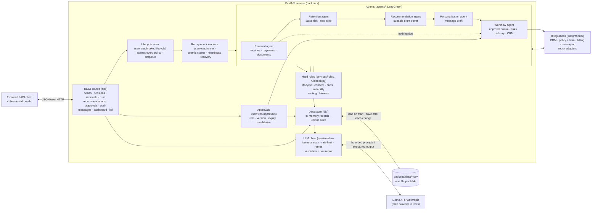
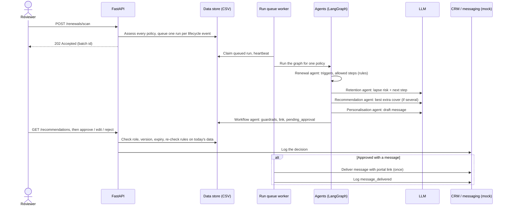

# System architecture

This document describes the backend of the use case 5 proof of concept: policy renewals, retention and personalised offers. The backend runs the agents and owns all data; any frontend talks to it through the HTTP API.

## Component and data-flow diagram

## Workflow sequence

## Runtime and boundaries

- **Entry point:** `main.py` builds the FastAPI app, installs CORS, loads the CSV data and starts the run-queue workers. Run it from the repository root with `uvicorn main:app`.
- **Agents:** `backend/agents/` has one folder per agent (`renewal`, `retention`, `recommendation`, `personalisation`, `workflow`) plus `shared/` (node wrapper, decision helpers, LLM-safe features). `graph.py` wires them; `state.py` is the state they pass along.
- **Decision safety:** Python rules decide what is allowed. Model output is validated and cannot overrule the rules. Approval is a separate human action, checked by role and recommendation version, and edits are validated again before commit.
- **Storage:** every table is a CSV file in `backend/data/` (`DATA_DIR`).
  - On start the files are loaded into memory.
  - After each unit of work, the changed tables are written back with an atomic file replace.
  - The app runs on one asyncio event loop, so a check-then-write with no `await` in between is atomic. This gives atomic run claims and first-decision-wins approvals without a database.
  - The store enforces unique rules: one active run per policy, one open recommendation per lifecycle event, one approval per recommendation.
- **External services:** the LLM provider is chosen by backend settings, and credentials stay server-side. CRM, policy administration, billing and messaging are integration protocols with mock implementations (`backend/integrations/`). The CRM mock writes `crm_activities.csv`.
- **Verification:** `backend/tests/` holds unit and integration tests. Run `python -m pytest` from the repository root.

## Deployment notes

The repository defines no hosting provider, container image or CI/CD workflow. A deployment needs to provide these:

- **One backend process:** the data folder is owned by a single process.
- **A persistent `DATA_DIR`:** the CSV files are the only storage.
- **`CORS_ORIGINS`:** must include the frontend origin.
- **LLM credentials:** set in the backend environment.

Moving to a multi-process deployment would mean replacing `backend/db/store.py` with a database-backed store behind the same repository functions.
